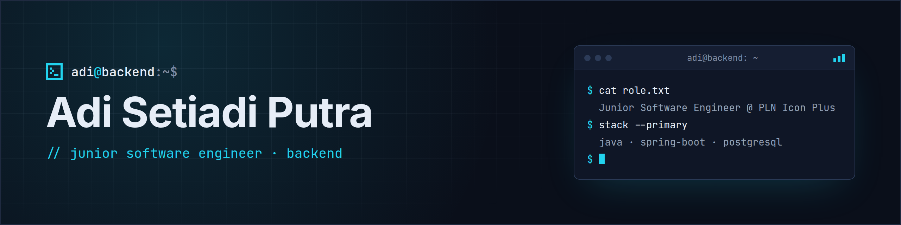

  

  Backend engineer building enterprise services with <b>Java</b>, <b>Spring Boot</b>, and <b>PostgreSQL</b>.

  
  
  

## About

- Junior Software Engineer at **PLN Icon Plus**, working on the backend of **HXMS**, an enterprise application for employee-related processes and organizational data.
- I focus on clean REST APIs, reliable business logic, and well-structured data in PostgreSQL.
- Open to conversations about backend engineering and collaboration.

## Experience

**Junior Software Engineer** · PLN Icon Plus — Bidang Digitalisasi PLN 2, HXMS team Oct 2025 – Present · Full-time

- Contribute to the development of HXMS, an enterprise application that supports employee-related processes and organizational data management.
- Develop RESTful APIs and implement backend business logic to support application workflows and align system behavior with business requirements.
- Maintain data processing and database interactions using Spring Boot and PostgreSQL to support reliable, structured application services.

**Backend Developer Intern** · PLN Icon Plus Sep 2024 – Jan 2025 · Internship

- Designed and implemented REST APIs with Java Spring Boot for electricity voucher creation and printing in Voltrik.
- Built the reporting module and optimized PostgreSQL queries for transaction monitoring.
- Shipped changes through the team's GitLab CI/CD pipeline and tracked work in Jira.

**Mobile Development Cohort** · Bangkit Academy 2024, led by Google Feb 2024 – Jul 2024

- Built Android applications in Kotlin and completed a capstone project (Recout) with a cross-functional team.

## Tech Stack

  <b>Languages</b> 
  
  

  <b>Backend</b> 
  
  
  
  

  <b>Database</b> 
  

  <b>Tools</b> 
  
  
  
  

## Featured Projects

| Project | Description | Stack |
| :------ | :---------- | :---- |
| [User Management API](https://github.com/adisputraa/user-management) | REST API with Keycloak authentication, role-based access control, and Testcontainers integration tests. | Java · Spring Boot · Keycloak · PostgreSQL · Docker |
| [PDF Toolkit API](https://github.com/adisputraa/pdf-service-api) | Stateless microservice for PDF manipulation with asynchronous job processing and persistent job tracking. | Node.js · TypeScript · Express · PostgreSQL · Docker |
| [Portfolio](https://github.com/adisputraa/portfolio-astro-2025) | Bilingual (EN/ID) static portfolio site. Live at [adisetdev.netlify.app](https://adisetdev.netlify.app/). | Astro · TypeScript · CSS |
| [Recout](https://github.com/C241-PS139/Recout) | Bangkit Academy 2024 capstone project, built with a cross-functional team. | Kotlin · Android |

## Education

**Institut Teknologi PLN** — Bachelor's Degree in Informatics Engineering 2021 – 2025 · GPA 3.84 / 4.00

Certifications include Microsoft Azure AI Fundamentals, AWS Cloud & Gen AI basics, and Bangkit Academy 2024. [See all certifications →](https://adisetdev.netlify.app/certifications/)
